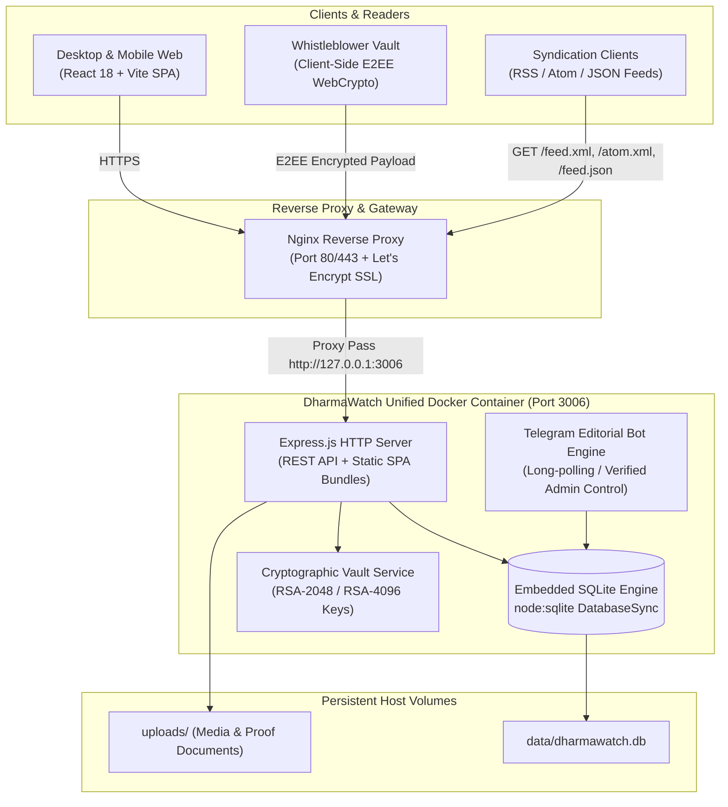
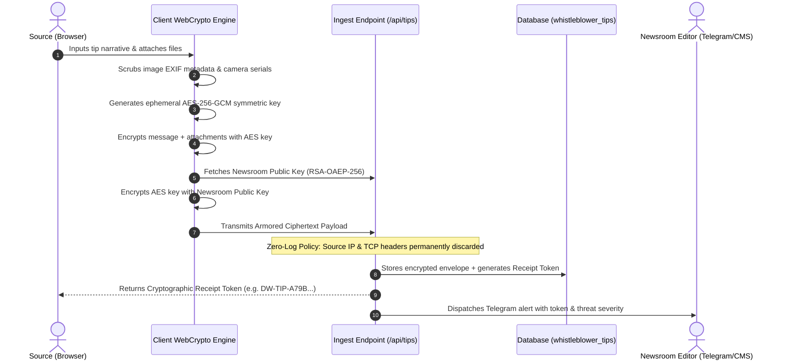

# The Dharma Watch (thedharmawatch.in) — Official Source Code

> **This repository contains the complete, official open-source codebase of [The Dharma Watch](https://thedharmawatch.in)** — India's independent investigative broadsheet and archival journal of record.
>
> Engineered in **TypeScript (100% Full-Stack)** across both frontend and backend, powered by **React 18**, **Node.js 22 LTS**, **Tailwind CSS**, and **Express.js**, backed by an embedded **SQLite (`node:sqlite`)** database engine, **WebCrypto RSA-OAEP / AES-256-GCM** client-side whistleblower encryption, an autonomous headless **Telegram Newsroom Bot**, and multi-format wire syndication (**RSS 2.0 / Atom 1.0 / JSON Feed 1.1**).

---

<details open>
<summary><strong>1. Executive Summary &amp; Core Tech Stack</strong></summary>
<br/>

### Platform Overview
**The Dharma Watch** is an open-source investigative newsroom platform and archival journal of record. Built for independent journalism organizations, civil society auditors, and watchdog collectives, it unifies long-form evidentiary investigative reporting, primary judicial case docket tracking, client-side encrypted whistleblower intake, automated media syndication, and headless Telegram-driven editorial workflows into a single deployable container.

### Technology Stack Matrix
| Layer | Technologies &amp; Libraries | Purpose |
| :--- | :--- | :--- |
| **Frontend Framework** | **React 18**, TypeScript, Vite | Component-driven reactive user interface with fast client routing. |
| **Styling &amp; UX** | **Tailwind CSS**, Lucide React, Broadsheet Typography | High-contrast newsprint aesthetics, readable serifs, responsive layout. |
| **Backend Runtime** | **Node.js 22 LTS**, Express.js, TypeScript (`tsx`) | High-throughput REST API and static asset delivery. |
| **Database Engine** | **SQLite** (`node:sqlite` DatabaseSync) | Zero-maintenance embedded relational database running in WAL mode. |
| **Cryptographic Engine** | **WebCrypto API**, RSA-OAEP-256, AES-256-GCM | Client-side E2EE whistleblower payload encryption before transport. |
| **Editorial Bot** | **Telegram Bot API** (Long-polling / Node.js) | Full remote newsroom administration, post creation, and leak triage. |
| **Deployment** | **Docker &amp; Docker Compose**, Multi-Stage Build | Single-command container deployment with persistent volume mounts. |

</details>

---

<details>
<summary><strong>2. System Architecture &amp; Component Topology</strong></summary>
<br/>



### Architectural Guarantees
- **Zero Database Daemon Overhead:** No external MySQL, PostgreSQL, or Redis instance required. Native Node.js 22 SQLite handles high concurrent read traffic in WAL mode.
- **Client-Side Privacy:** Whistleblower submissions are encrypted on the source device using browser Web Crypto APIs before transmission over HTTPS.
- **Zero IP Retention:** Ingest routes discard TCP source IP headers and browser user-agent fingerprints upon receipt.

</details>

---

<details>
<summary><strong>3. Credentials &amp; Prerequisites Acquisition Guide</strong></summary>
<br/>

If setting up a fresh deployment of this platform, here is where and how to obtain each required credential:

### A. Telegram Bot Token (@BotFather)
1. Open Telegram and search for the official **[@BotFather](https://t.me/BotFather)**.
2. Send `/newbot` and choose a display name (e.g. `My Newsroom Bot`) and unique handle (e.g. `mynewsroom_bot`).
3. BotFather will return your HTTP API access token:
   ```text
   Use this token to access the HTTP API:
   1234567890:ABCDefGhIJKlmNoPQRsTUVwxyZ123456789
   ```
4. Place this token in `.env` as `TELEGRAM_BOT_TOKEN`.
5. *(Recommended)* Send `/setprivacy` in BotFather, choose your bot, and set it to **Disabled** so management messages are cleanly captured.

### B. Telegram Admin User ID (@userinfobot)
Only authorized Telegram IDs are allowed to publish news or inspect tips.
1. Start a chat with **[@userinfobot](https://t.me/userinfobot)**.
2. The bot will return your numeric User ID:
   ```text
   Id: 123456789
   First: Editor
   Username: your_username
   ```
3. Set in `.env`:
   ```env
   ADMIN_TELEGRAM_IDS=123456789
   ADMIN_TELEGRAM_USERNAMES=your_username
   ```

### C. Cryptographic JWT Secret
Generate a random 256-bit hexadecimal key using OpenSSL:
```bash
openssl rand -hex 32
```
Place the resulting string into `.env` as `JWT_SECRET`.

### D. Institutional Email Directory (11 Standard Mailboxes)
The platform is designed around 11 canonical email addresses (9 public, 2 private):
- **Public Ingest:** `contact@yourdomain.com`, `tips@yourdomain.com`, `leak@yourdomain.com`, `corrections@yourdomain.com`, `copyright@yourdomain.com`, `press@yourdomain.com`, `security@yourdomain.com`, `privacy@yourdomain.com`, `submissions@yourdomain.com`.
- **Private Desks:** `admin@yourdomain.com`, `newsroom@yourdomain.com`.

### E. Newsroom Vault PGP / RSA Keys
- The platform automatically generates a 2048/4096-bit RSA cryptographic keypair upon its initial startup in `data/keys/newsroom_vault_key.json`.
- The public key is served via `/api/tips/public-key` for browser-side encryption. The private key remains secure on the host filesystem.

</details>

---

<details>
<summary><strong>4. Environment Variables Configuration (.env)</strong></summary>
<br/>

Copy the included template to create your `.env` file:
```bash
cp .env.example .env
```

| Variable | Required | Default | Purpose &amp; Explanation |
| :--- | :---: | :--- | :--- |
| `PORT` | Optional | `3006` | Port the Express application listens on inside the container. |
| `NODE_ENV` | Optional | `production` | Deployment mode (`production` or `development`). |
| `COOKIE_SECURE` | Optional | `false` | Set to `true` when operating behind strict HTTPS SSL. |
| `JWT_SECRET` | **Required** | Seeded fallback | Cryptographic secret for signing CMS session tokens. |
| `PUBLIC_DOMAIN`| **Required** | `https://yourdomain.com` | Canonical domain for sitemaps, OpenGraph cards, and feeds. |
| `SITE_URL` | Optional | `https://yourdomain.com` | Internal base URL used by headless workers and the Telegram bot. |
| `TELEGRAM_BOT_TOKEN` | Optional | `""` | Telegram Bot API token obtained from `@BotFather`. |
| `ADMIN_TELEGRAM_IDS` | Optional | `""` | Comma-separated numeric Telegram User IDs granted admin rights. |
| `ADMIN_TELEGRAM_USERNAMES` | Optional | `""` | Comma-separated Telegram usernames granted admin rights. |
| `DOCS_ROUTE` | Optional | `/wire-specs-7x9q2p` | Secret endpoint path for syndication &amp; API documentation. |
| `DATA_DIR` | Optional | `./data` | Filesystem path for SQLite database and key files. |

</details>

---

<details>
<summary><strong>5. Production Hosting &amp; Deployment Methods</strong></summary>
<br/>

### Method 1: Docker Compose (Recommended Production Setup)
This bundles the Vite production build and the Node.js 22 runtime into a multi-stage Docker image with persistent filesystem mounts.

```bash
# 1. Clone repository
git clone https://github.com/utkarshdubey2008/DharmaWatch.git /var/www/dharmawatch
cd /var/www/dharmawatch

# 2. Configure environment
cp .env.example .env
nano .env

# 3. Build and launch container in background
docker compose up -d --build

# 4. View real-time logs
docker compose logs -f
```

### Method 2: Bare-Metal VPS with PM2 (Ubuntu/Debian)
If hosting natively without Docker on an Ubuntu/Debian server:
```bash
# 1. Install Node.js 22 LTS
curl -fsSL https://deb.nodesource.com/setup_22.x | sudo -E bash -
sudo apt-get install -y nodejs

# 2. Install dependencies & build
cd /var/www/dharmawatch
npm ci
npm run build

# 3. Start with PM2 Process Manager
sudo npm install -g pm2
pm2 start ecosystem.config.cjs --env production
pm2 save
pm2 startup
```

### Method 3: Production Nginx Reverse Proxy with Let's Encrypt SSL
Create `/etc/nginx/sites-available/yourdomain.com`:
```nginx
server {
    server_name yourdomain.com www.yourdomain.com;
    client_max_body_size 100M;

    location / {
        proxy_pass http://127.0.0.1:3006;
        proxy_http_version 1.1;
        proxy_set_header Upgrade $http_upgrade;
        proxy_set_header Connection 'upgrade';
        proxy_set_header Host $host;
        proxy_cache_bypass $http_upgrade;
        proxy_set_header X-Real-IP $remote_addr;
        proxy_set_header X-Forwarded-For $proxy_add_x_forwarded_for;
        proxy_set_header X-Forwarded-Proto $scheme;
    }

    location /assets/ {
        proxy_pass http://127.0.0.1:3006;
        proxy_cache_valid 200 30d;
        add_header Cache-Control "public, max-age=2592000, immutable";
    }

    location /uploads/ {
        proxy_pass http://127.0.0.1:3006;
        add_header Cache-Control "public, max-age=604800";
    }
}
```
Enable site and acquire SSL:
```bash
sudo ln -s /etc/nginx/sites-available/yourdomain.com /etc/nginx/sites-enabled/
sudo nginx -t && sudo systemctl reload nginx
sudo certbot --nginx -d yourdomain.com -d www.yourdomain.com
```

### Method 4: Local Development Environment
```bash
npm install
# Terminal 1: Vite HMR frontend (port 5173)
npm run dev
# Terminal 2: Backend server (port 3001)
npm run server
```

</details>

---

<details>
<summary><strong>6. Initial Seeded Admin Access &amp; Credentials</strong></summary>
<br/>

When the database is initialized, three role accounts are pre-seeded:

| Role | Username | Seeded Email | Default Password | Permissions |
| :--- | :--- | :--- | :--- | :--- |
| **Admin** | `editor` | `admin@yourdomain.com` | `bZz!S9&WA5T&p9bKxu` | Full system administration, publishing, user management &amp; audit logs. |
| **Reporter** | `reporter` | `newsroom@yourdomain.com` | `bZz!S9&WA5T&p9bKxu` | Article authoring, draft submission, media uploads. |
| **Contributor**| `contributor` | `submissions@yourdomain.com` | `bZz!S9&WA5T&p9bKxu` | External pitch authoring, guest draft creation (requires approval). |

> [!IMPORTANT]
> Immediately update the default password after deployment by visiting `/admin/login` &rarr; Settings &rarr; Change Password, or via the SQLite CLI.

</details>

---

<details>
<summary><strong>7. Whistleblower Ingest &amp; Cryptographic Security Architecture</strong></summary>
<br/>

The platform includes a client-side cryptographic intake engine located at `/tips`:



### Key Security Safeguards
1. **Client-Side Ingest:** Plaintext data is encrypted directly inside the browser using the WebCrypto API.
2. **Zero IP Retention:** TCP headers, IP addresses, and user-agent fingerprints are permanently discarded on arrival.
3. **EXIF Scrubbing:** Images and attachments are cleaned of GPS coordinates, camera serial numbers, and device timestamps before encryption.
4. **Receipt Tokens:** Whistleblowers can check their review progress via an anonymous receipt token without creating an account.

</details>

---

<details>
<summary><strong>8. Telegram Newsroom Command Center Manual</strong></summary>
<br/>

When `TELEGRAM_BOT_TOKEN` is configured in `.env`, newsroom editors can run commands directly from Telegram:

| Command | Permission | Description |
| :--- | :---: | :--- |
| `/start` / `/menu` | Public | Interactive newsroom command menu with verification. |
| `/help` | Admin | Complete interactive command documentation. |
| `/stats` | Admin | Real-time newsroom statistics (articles, leaks, subscribers). |
| `/newpost` | Admin | Interactive wizard to compose, title, and publish an article. |
| `/articles` | Admin | Lists latest published articles with unpublish/edit actions. |
| `/tips` | Admin | Whistleblower intake queue triage and status updates. |
| `/authors` | Admin | List and manage investigative correspondents. |
| `/addauthor` | Admin | One-line author registration (`Name \| Role \| Email`). |
| `/subscribers` | Admin | Circulation subscriber counts and newsletter dispatch. |
| `/broadcast` | Admin | Broadcasts breaking news alerts to active subscribers. |
| `/audit` | Admin | Queries the latest system modifications and access ledger. |
| `/docs` / `/specs` | Admin | Secret link to private RSS/JSON feed documentation. |

</details>

---

<details>
<summary><strong>9. Syndication Feeds &amp; Secret API Documentation</strong></summary>
<br/>

The platform exposes real-time automated syndication feeds conforming to international wire standards:

- **RSS 2.0 Feed:** `https://yourdomain.com/api/feed/rss` (or `/feed.xml`)
- **Atom 1.0 Feed:** `https://yourdomain.com/api/feed/atom` (or `/atom.xml`)
- **JSON Feed 1.1:** `https://yourdomain.com/api/feed/json` (or `/feed.json`)
- **XML News Sitemap:** `https://yourdomain.com/news-sitemap.xml`
- **Master Sitemap:** `https://yourdomain.com/sitemap.xml`

### Private Technical Documentation Portal
- **Endpoint Route:** Configured in `src/config/docsConfig.ts` (default: `/wire-specs-7x9q2p`).
- **Crawler Protection:** The documentation endpoint is blocked in `robots.txt` (`Disallow: /wire-specs-`) so search engines do not index it.
- **Contents:** Full JSON schemas, XML parsing examples (Python, Node.js, Go), and cURL webhooks for cross-posting to external networks.

</details>

---

<details>
<summary><strong>10. Database Administration, Atomic WAL Backups &amp; Disaster Recovery</strong></summary>
<br/>

DharmaWatch stores all data in an embedded SQLite database at `data/dharmawatch.db`. Because it runs in WAL mode (`journal_mode=WAL`), hot backups can be taken without downtime.

### Atomic Backup One-Liner
```bash
sqlite3 data/dharmawatch.db ".backup 'data/backup_$(date +%Y%m%d_%H%M%S).db'"
```

### Automated Nightly Backup Cron
Add to crontab (`crontab -e`):
```bash
0 3 * * * sqlite3 /var/www/dharmawatch/data/dharmawatch.db ".backup '/var/www/dharmawatch/data/backup_\$(date +\%F).db'" && find /var/www/dharmawatch/data -name "backup_*.db" -mtime +14 -delete
```

### Database Schema Table Inventory
- `articles`: Published reports, decks, categories, citations, and read times.
- `case_files`: Investigative dossiers, timelines, and court dockets.
- `whistleblower_tips`: Client-side encrypted envelopes and receipt tokens.
- `authors`: Bylines, investigative desks, and bios.
- `users`: CMS logins, hashed passwords (bcrypt), and roles.
- `subscribers`: Verified email circulation recipients.
- `audit_logs`: Immutable security ledger for editorial actions.

</details>

---

<details>
<summary><strong>11. Production Troubleshooting &amp; Frequently Asked Questions</strong></summary>
<br/>

### Q: Port 3006 is already in use
Check what process is bound to port 3006:
```bash
lsof -i :3006
```
To change the port, set `PORT=3008` in `.env` and restart:
```bash
docker compose up -d
```

### Q: How do I recover or reset the Admin password?
Execute this one-liner inside the container to reset the password for user `editor`:
```bash
docker exec -it dharmawatch node -e '
const bcrypt = require("bcryptjs");
const { DatabaseSync } = require("node:sqlite");
const db = new DatabaseSync("/app/data/dharmawatch.db");
const hash = bcrypt.hashSync("MyNewPassword123!", 10);
db.prepare("UPDATE users SET password_hash = ? WHERE username = ?").run(hash, "editor");
console.log("Password updated successfully!");
'
```

### Q: Telegram Bot reports 409 Conflict
If logs report `409 Conflict: terminated by other getUpdates request`, another instance of the bot is currently running using the same `TELEGRAM_BOT_TOKEN`. Terminate old processes or generate a fresh token in `@BotFather`.

### Q: How to test the full-screen search?
Tap the search icon in the header. The view expands into a full-screen search overlay with pill input, close button (`X`), persistent search history, and live debounced results.

</details>

---

## License & Attribution

&copy; 2026 **The Dharma Watch**. Adhering to Press Council of India standards of verification, non-partisanship, and editorial integrity.
Public code released under the [MIT License](LICENSE).
