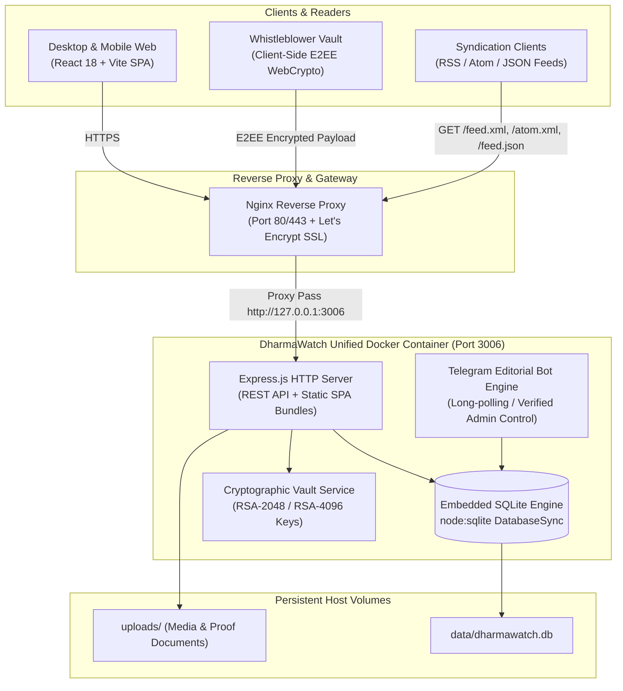
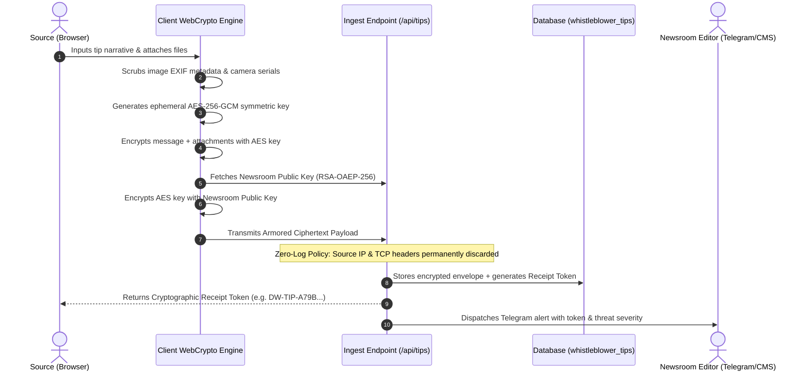

# The Dharma Watch (thedharmawatch.in)

> **India's Independent Investigative Journal of Record**  
> *Evidence-first, source-driven, constitutional, and editorially rigorous.*

---

## Table of Contents

- [Overview & Philosophy](#overview--philosophy)
- [System Architecture](#system-architecture)
- [Credentials & Prerequisites Guide](#credentials--prerequisites-guide)
  - [1. Telegram Bot Token (@BotFather)](#1-telegram-bot-token-botfather)
  - [2. Telegram Admin Numeric ID (@userinfobot)](#2-telegram-admin-numeric-id-userinfobot)
  - [3. Strong JWT Secret Generation](#3-strong-jwt-secret-generation)
  - [4. Institutional Email Directory (11 Mailboxes)](#4-institutional-email-directory-11-mailboxes)
  - [5. Newsroom Cryptographic Vault Keys](#5-newsroom-cryptographic-vault-keys)
- [Environment Variables (.env)](#environment-variables-env)
- [Deployment & Hosting Methods](#deployment--hosting-methods)
  - [Method 1: Docker Compose (Recommended Production Setup)](#method-1-docker-compose-recommended-production-setup)
  - [Method 2: Bare-Metal VPS with PM2 / Systemd](#method-2-bare-metal-vps-with-pm2--systemd)
  - [Method 3: Nginx Reverse Proxy & SSL (Certbot)](#method-3-nginx-reverse-proxy--ssl-certbot)
  - [Method 4: Local Development Environment](#method-4-local-development-environment)
- [Default Newsroom Credentials](#default-newsroom-credentials)
- [Whistleblower Intake & Security Protocol](#whistleblower-intake--security-protocol)
- [Newsroom Telegram Bot Commands](#newsroom-telegram-bot-commands)
- [Syndication Feeds & Technical Docs](#syndication-feeds--technical-docs)
- [Database Maintenance & Backups](#database-maintenance--backups)
- [Troubleshooting & FAQ](#troubleshooting--faq)

---

## Overview & Philosophy

**The Dharma Watch** (`thedharmawatch.in`) is an open-source investigative newsroom platform and archival journal of record. It combines long-form evidentiary investigative reporting, primary judicial case docket tracking, client-side encrypted whistleblower intake, automated media syndication, and headless Telegram-driven editorial command workflows.

### Core Architectural Pillars

- **Evidence-First Broadsheet Design:** Restrained aesthetics, high contrast, clean broadsheet typography, responsive layout, and full-screen mobile search.
- **Client-Side Cryptographic Intake:** Whistleblower tips are encrypted in the browser with RSA-OAEP-256 + AES-256-GCM before transmission. Connection IPs and metadata headers are discarded on ingest.
- **Single-Binary Zero-Dependency Backend:** Built on Node.js 22 native `node:sqlite` (`DatabaseSync`), requiring zero external database daemon (PostgreSQL/MySQL) setup or cloud lock-in.
- **Headless Editorial Telegram Bot:** Complete newsroom administration — publishing articles, moderating leaks, inspecting audit logs, managing correspondents, and querying analytics via Telegram.
- **Universal Multi-Format Syndication:** Standards-compliant RSS 2.0, Atom 1.0, and JSON Feed 1.1 endpoints for wire syndication and cross-platform distribution.

---

## System Architecture



---

## Credentials & Prerequisites Guide

For a newcomer setting up this platform from scratch, here is exactly where and how to obtain every credential.

<details>
<summary><strong>1. Telegram Bot Token (@BotFather) &mdash; Click to Expand</strong></summary>

The Telegram Bot allows authorized editors to publish articles, inspect whistleblower tips, view audit logs, and trigger broadcast updates directly from Telegram.

1. Open Telegram and search for the official **[@BotFather](https://t.me/BotFather)** (verified badge).
2. Start the chat and send `/newbot`.
3. Enter a friendly display name (e.g. `DharmaWatch Editorial Bot`).
4. Enter a unique username ending in `bot` (e.g. `dharmawatch_news_bot`).
5. BotFather will reply with your HTTP API token:
   ```text
   Use this token to access the HTTP API:
   1234567890:ABCDefGhIJKlmNoPQRsTUVwxyZ123456789
   ```
6. Copy this string and paste it into `.env` as `TELEGRAM_BOT_TOKEN`.
7. *(Recommended)* In BotFather, send `/setprivacy`, choose your bot, and set it to **Disabled** so the bot can process management inputs cleanly.

</details>

<details>
<summary><strong>2. Telegram Admin Numeric ID (@userinfobot) &mdash; Click to Expand</strong></summary>

Only specified Telegram User IDs are granted administrative access to manage articles, approve drafts, or view whistleblower submissions.

1. Open Telegram and start a chat with **[@userinfobot](https://t.me/userinfobot)** or **[@raw_data_bot](https://t.me/raw_data_bot)**.
2. The bot will instantly reply with your account details:
   ```text
   Id: 123456789
   First: Editor
   Username: your_username
   ```
3. Copy the numeric `Id` (e.g. `123456789`) and your username without the `@`.
4. In your `.env` file, specify:
   ```env
   ADMIN_TELEGRAM_IDS=123456789
   ADMIN_TELEGRAM_USERNAMES=your_username
   ```
   *(Multiple admins can be added as comma-separated values: `123456789,987654321`)*.

</details>

<details>
<summary><strong>3. Strong JWT Secret Generation &mdash; Click to Expand</strong></summary>

The platform issues signed JSON Web Tokens (JWT) for secure authentication to the `/admin` CMS dashboard.

Generate a secure, random 256-bit hexadecimal string using OpenSSL in your terminal:

```bash
openssl rand -hex 32
```

*Example Output:*
```text
4a9f3b1e7c8d205f96e41b8a3d5e2c7f01a8b9c4d7e6f5a3b2c1d0e9f8a7b6c5
```

Copy the generated hash into `.env`:
```env
JWT_SECRET=4a9f3b1e7c8d205f96e41b8a3d5e2c7f01a8b9c4d7e6f5a3b2c1d0e9f8a7b6c5
```

</details>

<details>
<summary><strong>4. Institutional Email Directory (11 Mailboxes) &mdash; Click to Expand</strong></summary>

The codebase is strictly configured to use **11 official email addresses** on `thedharmawatch.in` (9 public, 2 private). Set these up in your email provider (Google Workspace, Zoho Mail, MXroute, or cPanel):

### Public Addresses (Public-Facing Ingest)
1. `contact@thedharmawatch.in` &mdash; General institutional inquiries, rights, and editorial inquiries.
2. `tips@thedharmawatch.in` &mdash; Ground reporting, whistleblower leads, and investigative documents.
3. `leak@thedharmawatch.in` &mdash; Dedicated PGP cryptographic vault inbox for sensitive materials.
4. `corrections@thedharmawatch.in` &mdash; Transparency ledger, factual clarifications, and PCI complaints.
5. `copyright@thedharmawatch.in` &mdash; Syndication rights, DMCA, and legal notice correspondence.
6. `press@thedharmawatch.in` &mdash; Media relations, press releases, and interview requests.
7. `security@thedharmawatch.in` &mdash; Responsible vulnerability disclosure and encryption keys.
8. `privacy@thedharmawatch.in` &mdash; Data governance, GDPR/DPDP inquiries, and record compliance.
9. `submissions@thedharmawatch.in` &mdash; External op-ed pitches, author essays, and investigative drafts.

### Private / Internal Addresses
10. `admin@thedharmawatch.in` &mdash; System root administrator and CMS authentication identity.
11. `newsroom@thedharmawatch.in` &mdash; Central newsroom dispatch and internal correspondent alias.

</details>

<details>
<summary><strong>5. Newsroom Cryptographic Vault Keys &mdash; Click to Expand</strong></summary>

The platform automatically generates an RSA-2048/4096 cryptographic keypair upon its first boot if one does not already exist in `data/newsroom_vault_key.json`.

- **Public Key:** Exposed via `/api/tips/public-key` so user browsers can encrypt submissions using WebCrypto before transmitting.
- **Private Key:** Stored strictly inside `data/newsroom_vault_key.json` (chmod 600) on the server, ensuring newsroom staff can decrypt confidential submissions.
- **Zero Configuration Needed:** You do not need to manually generate PGP keys; the server creates, verifies, and calculates the public key fingerprint automatically on startup.

</details>

---

## Environment Variables (.env)

Create a `.env` file in the project root:

```bash
cp .env.example .env
```

| Variable | Required | Default | Description |
| :--- | :---: | :--- | :--- |
| `PORT` | Optional | `3006` | Port the Express application listens on inside the container. |
| `NODE_ENV` | Optional | `production` | Environment mode (`production` or `development`). |
| `COOKIE_SECURE` | Optional | `false` | Set to `true` if serving behind strict HTTPS SSL termination. |
| `JWT_SECRET` | **Required** | Seeded fallback | Cryptographic secret used to sign newsroom admin JWT tokens. |
| `PUBLIC_DOMAIN`| **Required** | `https://thedharmawatch.in` | Canonical domain used in OpenGraph tags, sitemaps, and RSS feeds. |
| `SITE_URL` | Optional | `https://thedharmawatch.in` | Base URL used by internal services and the Telegram bot. |
| `TELEGRAM_BOT_TOKEN` | Optional | `""` | Telegram Bot token obtained from `@BotFather`. |
| `ADMIN_TELEGRAM_IDS` | Optional | `""` | Comma-separated list of numeric Telegram User IDs with admin access. |
| `ADMIN_TELEGRAM_USERNAMES` | Optional | `""` | Comma-separated list of Telegram usernames allowed admin access. |
| `DATA_DIR` | Optional | `./data` | Directory where SQLite database and cryptographic keys reside. |

---

## Deployment & Hosting Methods

<details open>
<summary><strong>Method 1: Docker Compose (Recommended Production Setup)</strong></summary>

This is the standard, zero-friction production method. It bundles the Vite production build and the Node.js 22 runtime into a multi-stage Docker image with persistent filesystem mounts.

### Step 1: Clone Repository
```bash
git clone https://github.com/your-username/dharmawatch.git /root/dharmawatch
cd /root/dharmawatch
```

### Step 2: Configure Environment
```bash
cp .env.example .env
nano .env   # Update TELEGRAM_BOT_TOKEN, ADMIN_TELEGRAM_IDS, JWT_SECRET
```

### Step 3: Launch with Docker Compose
```bash
docker compose up -d --build
```

### Step 4: Verify Deployment
```bash
# Check container status
docker ps | grep dharmawatch

# Test local health endpoint
curl -I http://127.0.0.1:3006/api/health
```

### Container Management Commands
```bash
# View real-time logs
docker compose logs -f

# Restart container after config change
docker compose restart

# Update source and rebuild container
git pull
docker compose up -d --build
```

</details>

<details>
<summary><strong>Method 2: Bare-Metal VPS with PM2 / Systemd &mdash; Click to Expand</strong></summary>

If running directly on Ubuntu/Debian without Docker:

### 1. Install Node.js 22 (LTS)
```bash
curl -fsSL https://deb.nodesource.com/setup_22.x | sudo -E bash -
sudo apt-get install -y nodejs
node -v   # Must report v22.x or higher for node:sqlite
```

### 2. Install Project Dependencies & Build
```bash
cd /var/www/dharmawatch
npm ci
npm run build
```

### 3. Start with PM2
```bash
sudo npm install -g pm2
pm2 start ecosystem.config.cjs --env production
pm2 save
pm2 startup
```

### 4. Or Run via Systemd Unit File
Create `/etc/systemd/system/dharmawatch.service`:
```ini
[Unit]
Description=The Dharma Watch Newsroom Service
After=network.target

[Service]
Type=simple
User=root
WorkingDirectory=/var/www/dharmawatch
ExecStart=/usr/bin/node --loader tsx server/index.ts
Restart=always
RestartSec=5
Environment=NODE_ENV=production
Environment=PORT=3006
EnvironmentFile=/var/www/dharmawatch/.env

[Install]
WantedBy=multi-user.target
```

Enable and start the service:
```bash
sudo systemctl daemon-reload
sudo systemctl enable --now dharmawatch
sudo systemctl status dharmawatch
```

</details>

<details>
<summary><strong>Method 3: Nginx Reverse Proxy & SSL (Certbot) &mdash; Click to Expand</strong></summary>

To serve the application securely over HTTPS with HTTP/2 and standard security headers, point Nginx to port `3006`.

### 1. Install Nginx and Certbot
```bash
sudo apt update
sudo apt install -y nginx certbot python3-certbot-nginx
```

### 2. Create Nginx Configuration
Create `/etc/nginx/sites-available/thedharmawatch.in`:
```nginx
server {
    server_name thedharmawatch.in www.thedharmawatch.in;

    client_max_body_size 100M;

    location / {
        proxy_pass http://127.0.0.1:3006;
        proxy_http_version 1.1;
        proxy_set_header Upgrade $http_upgrade;
        proxy_set_header Connection 'upgrade';
        proxy_set_header Host $host;
        proxy_cache_bypass $http_upgrade;

        proxy_set_header X-Real-IP $remote_addr;
        proxy_set_header X-Forwarded-For $proxy_add_x_forwarded_for;
        proxy_set_header X-Forwarded-Proto $scheme;
    }

    # Cache static frontend assets
    location /assets/ {
        proxy_pass http://127.0.0.1:3006;
        proxy_cache_valid 200 30d;
        add_header Cache-Control "public, max-age=2592000, immutable";
    }

    # Uploads directory
    location /uploads/ {
        proxy_pass http://127.0.0.1:3006;
        add_header Cache-Control "public, max-age=604800";
    }
}
```

### 3. Enable Site & Request Free SSL Certificate
```bash
sudo ln -s /etc/nginx/sites-available/thedharmawatch.in /etc/nginx/sites-enabled/
sudo nginx -t
sudo systemctl reload nginx

# Request Let's Encrypt SSL
sudo certbot --nginx -d thedharmawatch.in -d www.thedharmawatch.in
```

</details>

<details>
<summary><strong>Method 4: Local Development Environment &mdash; Click to Expand</strong></summary>

To develop new features or test changes locally:

```bash
# 1. Clone repository
git clone https://github.com/your-username/dharmawatch.git
cd dharmawatch

# 2. Install dependencies (Requires Node.js 22+)
npm install

# 3. Start local development servers:
# Terminal 1: Frontend Vite Dev Server (Hot Module Reloading on port 5173)
npm run dev

# Terminal 2: Backend Express Dev Server (Node 22 with TSX on port 3001)
npm run server
```

Open `http://localhost:5173` in your browser. All `/api` requests from Vite are automatically proxied to the backend.

</details>

---

## Default Newsroom Credentials

When the database is seeded for the first time, three administrative role accounts are initialized:

| Role | Username | Seeded Email | Default Password | Permissions |
| :--- | :--- | :--- | :--- | :--- |
| **Admin** | `editor` | `admin@thedharmawatch.in` | `bZz!S9&WA5T&p9bKxu` | Full system access, publishing, user creation, settings & audit logs |
| **Reporter** | `reporter` | `newsroom@thedharmawatch.in` | `bZz!S9&WA5T&p9bKxu` | Article authoring, draft submission, media uploads |
| **Contributor**| `contributor` | `submissions@thedharmawatch.in` | `bZz!S9&WA5T&p9bKxu` | External pitch authoring, draft creation (requires approval) |

> [!IMPORTANT]
> Change the default passwords immediately upon deployment by navigating to **`/admin/login` &rarr; Settings &rarr; Change Password**, or via the SQLite CLI.

---

## Whistleblower Intake & Security Protocol

The platform features an advanced client-side cryptographic ingest engine located at [`/tips`](file:///root/dharmawatch/src/pages/ContactPage.tsx):



### OPSEC Properties
- **Client-Side Encryption:** Plaintext never touches the network; messages are encrypted before leaving the user's browser.
- **Zero IP Retention:** The Express endpoint explicitly omits recording TCP client IPs or user-agent fingerprint headers.
- **Exif Scrubbing:** File uploads are parsed in browser memory; GPS coordinates, camera serial numbers, and device timestamps are stripped before cipher packaging.
- **Cryptographic Receipt Tokens:** Sources track review status using an anonymous receipt token without creating an account or logging in.

---

## Newsroom Telegram Bot Commands

When `TELEGRAM_BOT_TOKEN` is configured, editors can manage the newsroom in real time:

| Command | Permission | Description |
| :--- | :---: | :--- |
| `/start` | Public | Launches interactive menu with verification check. |
| `/help` | Admin | Displays complete interactive command manual. |
| `/stats` | Admin | Real-time newsroom telemetry (articles count, unread leaks, subscribers). |
| `/newpost` | Admin | Step-by-step wizard to compose, title, and publish an article. |
| `/articles` | Admin | Lists recent articles with quick Edit/Unpublish actions. |
| `/tips` | Admin | Inspects confidential whistleblower intake queue and review status. |
| `/authors` | Admin | Views and registers new investigative correspondents and bylines. |
| `/addauthor`| Admin | One-line author registration (`Name \| Role \| Email`). |
| `/subscribers`| Admin | Views circulation metrics and triggers newsletter dispatch. |
| `/broadcast` | Admin | Broadcasts a breaking news alert to all active Telegram subscribers. |
| `/audit` | Admin | Queries the latest security and editorial modifications ledger. |
| `/docs` / `/specs` | Admin | Provides link to confidential RSS/JSON feed documentation. |

---

## Syndication Feeds & Technical Docs

The platform exposes real-time syndication feeds conforming to international wire standards:

- **RSS 2.0 Feed:** `https://thedharmawatch.in/api/feed/rss` (or `/feed.xml`)
- **Atom 1.0 Feed:** `https://thedharmawatch.in/api/feed/atom` (or `/atom.xml`)
- **JSON Feed 1.1:** `https://thedharmawatch.in/api/feed/json` (or `/feed.json`)
- **XML Sitemap:** `https://thedharmawatch.in/sitemap.xml`

<details>
<summary><strong>Confidential Feed Documentation & Integration Endpoints &mdash; Click to Expand</strong></summary>

For microservice syndication, automated social posters, or mobile app builders:
- **Interactive Documentation URL:** Configurable via `src/config/docsConfig.ts` (e.g. `https://yourdomain.com/wire-specs-7x9q2p`)
- This endpoint is explicitly masked from search engine web crawlers via `robots.txt` (`Disallow: /wire-specs-`).
- It contains complete JSON Schemas, XML parsing examples (Python, Node.js, Go), and cURL webhooks for listening to new published stories.

</details>

---

## Database Maintenance & Backups

DharmaWatch uses an embedded SQLite database located at `data/dharmawatch.db`. Because SQLite writes via WAL mode (`journal_mode=WAL`), atomic backups can be taken without stopping the container.

### 1. Manual Backup
```bash
sqlite3 data/dharmawatch.db ".backup 'data/backup_$(date +%Y%m%d_%H%M%S).db'"
```

### 2. Automated Daily Backup via Cron
Add a daily cronjob (`crontab -e`):
```bash
0 3 * * * sqlite3 /root/dharmawatch/data/dharmawatch.db ".backup '/root/dharmawatch/data/dharmawatch_backup_\$(date +\%F).db'" && find /root/dharmawatch/data -name "dharmawatch_backup_*.db" -mtime +14 -delete
```

### 3. Database Schema Overview
- `articles` &mdash; Published stories, category slugs, decks, evidence citations, hero images, and read times.
- `case_files` &mdash; Investigative dossiers, tracking numbers, timeline points, and judicial court dockets.
- `whistleblower_tips` &mdash; Client-side encrypted envelopes, receipt tokens, and status audit entries.
- `authors` &mdash; Newsroom bylines, investigative roles, and bio profiles.
- `users` &mdash; CMS accounts, hashed credentials (bcrypt), and permission roles (`admin`, `reporter`, `contributor`).
- `subscribers` &mdash; Verified reader circulation list for newsletter dispatch.
- `audit_logs` &mdash; Immutable ledger recording user actions, IP (admin actions only), and timestamp.

---

## Troubleshooting & FAQ

<details>
<summary><strong>Q: Container fails with "Address already in use :3006" &mdash; Click to Expand</strong></summary>

Another process or container is using port 3006. Check which process holds the port:
```bash
lsof -i :3006   # Or: ss -tulpn | grep 3006
```
To change the DharmaWatch host port, edit `.env`:
```env
PORT=3008
```
Then run: `docker compose up -d`

</details>

<details>
<summary><strong>Q: Telegram Bot does not respond to commands &mdash; Click to Expand</strong></summary>

1. Confirm that `TELEGRAM_BOT_TOKEN` in `.env` is valid and not empty.
2. Verify that your numeric Telegram ID is in `ADMIN_TELEGRAM_IDS`:
   ```bash
   grep "ADMIN_TELEGRAM" .env
   ```
3. Inspect the bot runtime logs:
   ```bash
   docker compose logs -f | grep -i telegram
   ```
4. If you see `409 Conflict: terminated by other getUpdates request`, ensure you do not have another instance of the bot running on another server.

</details>

<details>
<summary><strong>Q: How do I reset the Admin Password if locked out? &mdash; Click to Expand</strong></summary>

You can set a new bcrypt password directly via Node.js:

```bash
docker exec -it dharmawatch node -e '
const bcrypt = require("bcryptjs");
const { DatabaseSync } = require("node:sqlite");
const db = new DatabaseSync("/app/data/dharmawatch.db");
const hash = bcrypt.hashSync("MyNewSecurePassword123!", 10);
db.prepare("UPDATE users SET password_hash = ? WHERE username = ?").run(hash, "editor");
console.log("Password updated successfully!");
'
```

</details>

<details>
<summary><strong>Q: How do I test the full-screen search view? &mdash; Click to Expand</strong></summary>

Click the magnifying glass icon in the header on desktop or mobile. The view will animate into a full-screen search overlay with:
- Pill search input
- Prominent circular cut (`X`) button
- Real-time search history with diagonal jump arrows (`↗`)
- Instant debounced results for articles, case files, and authors.

</details>

---

## License & Attribution

&copy; 2026 **The Dharma Watch**. Adhering to the Press Council of India standards of verification, non-partisanship, and editorial integrity.
Public code released under the [MIT License](LICENSE).
